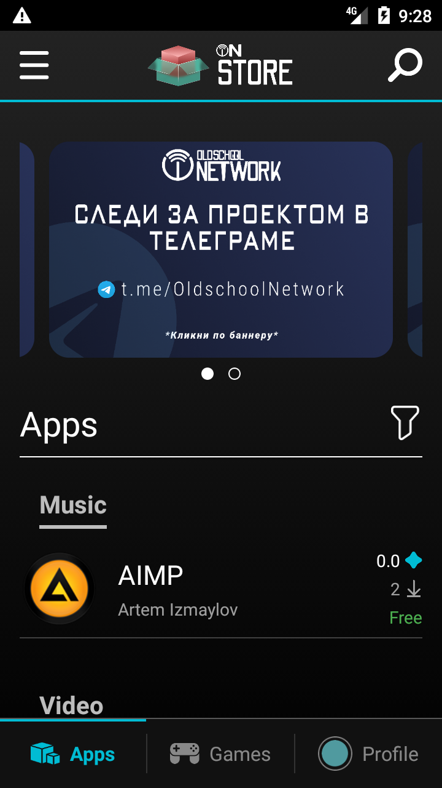
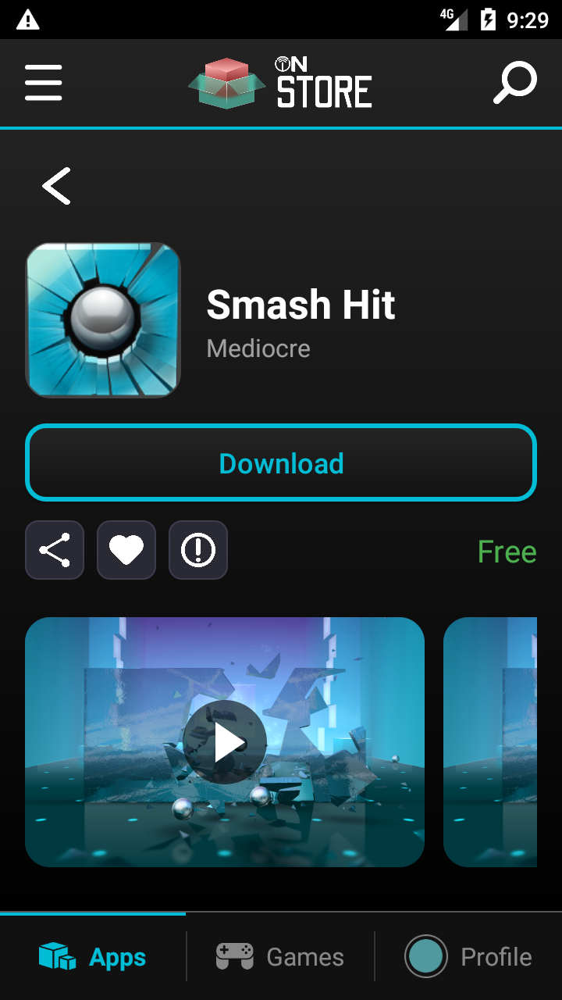

  

  <picture>
    <source media="(prefers-color-scheme: dark)" srcset="docs/branding/oldschool-network-dark.svg">
    
  </picture>

# ON Store

The application and game store for Oldschool Network.

Current alpha: **0.38** (version code 14). Android 4.0 / API 14 or later.

## Screenshots

  
  

## Features

- Online application and game catalogue, curated categories and version selection.
- Library, favorites, search and filters.
- Reviews, reactions, reports and public creator profiles.
- Package downloads, installation and an Update action beside Open. Background updates follow auto-update and network preferences.

## Downloads

Get signed APKs from [GitHub Releases](https://github.com/OldschoolNetwork/store/releases). Use [All downloads](https://oldschoolnetwork.online/downloads/) for individual services and archived versions. The main Download button provides the Classic Installer.

## Installation

Read the [installation guides](https://oldschoolnetwork.online/downloads/docs/categories/installation/). Full system setup requires a compatible rooted device; ordinary installation uses Android's package installer. Update an existing installation with APKs signed by the same certificate.

This is alpha software. Physical-device and firmware compatibility can differ from emulator results.

## Project

[Website](https://oldschoolnetwork.online/) · [Help](https://oldschoolnetwork.online/downloads/docs/) · [Platform Rules](https://api.oldschoolnetwork.online/v1/on-account/web/terms.html)

[Bluesky](https://bsky.app/profile/oldnet.bsky.social) · [YouTube](https://www.youtube.com/@oldschoolnetwork) · [X](https://x.com/oldschool_net) · [Telegram](https://t.me/OldschoolNetwork)
